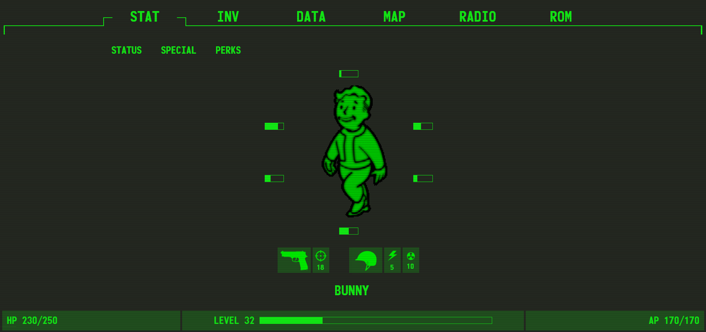

# Jailbreak

## Category: Web | Difficulty: Very Easy | Approach: Black-box

### PART I: Vulnerability

XML External Entity (XXE) Injection (CWE-611) in the firmware update feature (`POST /api/update`) allows an unauthenticated attacker to define and reference external entities within the submitted XML, enabling arbitrary local file disclosure on the server, including the flag.

---

### PART II: Application Mapping

- The application appears to be a game.
    
    
    
- But most of the features are just static pages.
- The `ROM` feature is the only one that accepts user input, and it takes XML data.
    
    
    
- Clicking the `Submit` button sends a POST request to `/api/update`. I can see that the `version` is reflected in the response.
    
    
    
- Here is the map:
    
    
    

---

### PART III: Exploitation

- Since only the `version` is reflected, I remove the remaining fields to make the request cleaner.
    
    
    
- And because I can control the XML input, I try referencing an external entity.
- The server resolves it and returns the referenced file's content.
    
    
    
- The challenge scenario also reveals that the flag is located at `/flag.txt`.
    
    
    
- So I change the entity's target to `/flag.txt` and reference it to retrieve the flag.
    
    
    

---

### PART IV: Impact

- The endpoint requires no authentication, so this is exploitable by anyone who can reach `/api/update` . Once exploited, an attacker may be able to read other local files accessible to the server process, such as configuration files, credentials, SSH keys, or application source code, by changing the SYSTEM entity's target path.
- **Severity: High -** Unauthenticated, arbitrary local file read.

---

### PART V: Root Cause & Remediation

#### Root Cause:

- **XML External Entity Injection (CWE-611):** The parser processing the submitted `FirmwareUpdateConfig` document resolves externally defined entities declared via `<!DOCTYPE ... [<!ENTITY ... SYSTEM "...">]>` and substitutes their resolved content wherever the entity is referenced in the document.
- **No restriction on the submitted document’s structure**: the endpoint accepts a full XML document from an untrusted client with no validation limiting it to the expected schema (e.g. only `Version`, `ReleaseDate`, etc.), so a client can introduce a `DOCTYPE` declaration the application was never designed to expect.

#### Remediation:

- **Disable DTD processing and external entity resolution at the parser level entirely**: most XML libraries support this explicitly (e.g., `defusedxml` for Python, or disabling `FEATURE_EXTERNAL_GENERAL_ENTITIES` / `FEATURE_EXTERNAL_PARAMETER_ENTITIES` for Java-based parsers). This should be the default posture for any parser handling untrusted input, not an opt-in.
- Validate the incoming document against a strict schema (e.g., XSD) before processing, rejecting any document containing a `DOCTYPE` declaration or unexpected structure.
- Apply least privilege to the file system access of the process parsing this XML, so that even a successful XXE cannot reach sensitive files beyond what the service legitimately needs.
