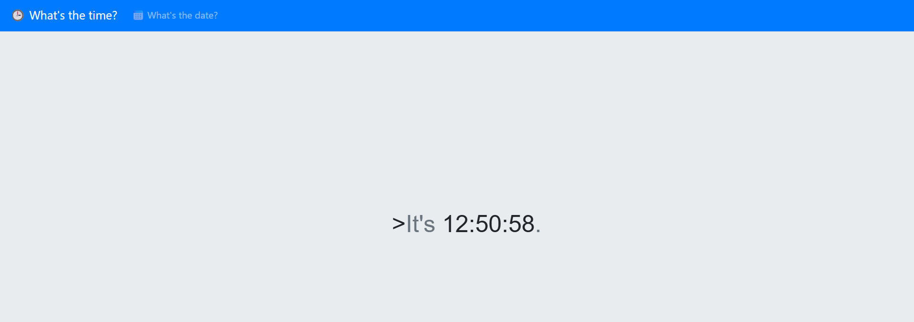

# TimeKORP

## Category: Web | Difficulty: Very Easy | Approach: White-box

### PART I: Vulnerability

OS Command Injection (CWE-78) in the `/?format=` parameter allows an unauthenticated attacker to execute arbitrary OS commands, caused by unsanitized user input being concatenated directly into a shell command string.

---

### PART II: Application Mapping

- This application has two features. The first one is "What's the time?”
    
    
    
- The other one is "What's the date?”
    
    
    
- The only difference is the value of the `format` parameter.
    
    
    

---

### PART III: Source Code Reviewing

- File: `challenge/controllers/TimeController.php` :
    
    
    
    - I can see that the `format` parameter is user-controlled.
    - The controller then creates a `TimeModel` object and passes `$format` as an argument.
- File: `challenge/models/TimeModel.php` :
    
    
    
    - The `$format` value is concatenated into the `command` property.
    - When `getTime()` is invoked, it calls `exec()` to execute the command.
    - Since I can control the `$format`, this leads to OS command injection.

---

### PART IV: Exploitation

- The command generated during normal operation looks like this:
    
    ```
    date '+ %H:%M:%S ' 2>&1
    ```
    
- So if I want to inject my command, I have to find a way to escape the original command first.
- I use this payload: `';id'` .
    
    ```
    date '+ ';id' '2>&1
    ```
    
    - The first single quote closes the original string `'+`.
    - The semicolon then terminates the original command and starts a new one, which is `id` in this case.
    - The last single quote absorbs the remaining quote before `2>&1`, keeping the resulting command syntactically valid.
- The response confirms that the `id` command was executed successfully.
    
    
    
- Since PHP's `exec()` returns only the last line of command output when no output array is provided, running `ls /` only displays `www` in this case.
    
    
    
- So I use the `find` command to locate the flag, since there is only one flag in this challenge.
    
    
    
- (Or you can check the Dockerfile to find its location.)
    
    
    
- The final step is to retrieve the flag.
    
    
    

---

### PART V: Impact

- The endpoint requires no authentication and is reachable through a simple GET request, making it exploitable by any remote attacker who can access the application. Successful exploitation provides arbitrary command execution in the context of the web server process (running as `www`), allowing an attacker to enumerate the filesystem and read files accessible to that user. The ability to locate and read `/flag` demonstrates this impact, while further consequences depend on the privileges and resources available to the `www` user.
- Severity: Critical - unauthenticated remote command execution.

---

### PART VI: Root Cause & Remediation

#### Root Cause:

- **OS Command Injection via unsanitized string concatenation (CWE-78)**: `TimeModel::__construct()` builds the shell command by directly concatenating the user-supplied `$format` into a string (`"date '+" . $format . "' 2>&1"`). Without escaping or allow-list validation, shell metacharacters such as `'` and `;` can break out of the intended quoted argument and introduce additional shell commands.
- **Unsafe shell invocation**: Even with input validation in place elsewhere, building the command as a string and passing it to `exec()` (which runs via `/bin/sh -c`) means any future change that reintroduces unsanitized input would immediately be exploitable again. Invoking `date` with arguments passed separately would remove this risk at the architecture level, independent of input validation.

#### Remediation:

- **Avoid shell command construction**: Never build shell commands by concatenating user-controlled input. Validate `$format` against a strict allow-list of supported date format specifiers and reject unexpected characters.
- **Use native PHP functionality**: Prefer PHP's native `date()` function instead of executing the system `date` binary. This removes the shell-injection surface from this feature entirely.
- **Use safe process invocation when necessary**: If shell execution is unavoidable, escape user-controlled arguments with `escapeshellarg()` and prefer APIs that accept an argument array without invoking a shell, where supported.
