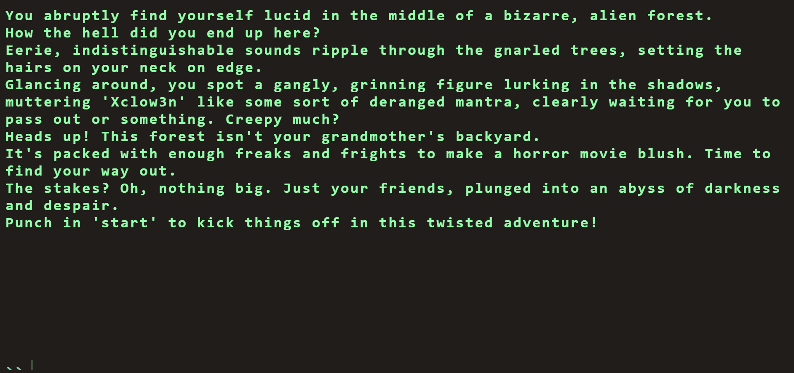

# Flag Command

---

### Category: Web | Difficulty: Very Easy | Approach: Black-box

---

#### PART I: Vulnerability

Sensitive data exposure (CWE-200) caused by the API exposing the secret winning command in its response, allowing the game to be completed without progressing through the intended stages.

---

#### PART II: The Process

- The UI is a terminal-style text game.
    
    
    
- Typing “start” presents four options and each of them will lead to different story branches.
    
    
    
- After exploring all the available options without finding the flag, I open the proxy and notice a GET request to `/api/options`.
    
    
    
- The response contains the options for all stages at once, not just the current one. And there is a `secret` field that the UI never renders.
    
    ```json
    {
      "allPossibleCommands": {
        "1": ["HEAD NORTH", "..."],
        "2": ["GO DEEPER INTO THE FOREST", "..."],
        "3": ["EXPLORE A CAVE", "..."],
        "4": ["ENTER A MAGICAL PORTAL", "..."],
        "secret": [
          "Blip-blop, in a pickle with a hiccup! Shmiggity-shmack"
        ]
      }
    }
    ```
    
- Submitting the `secret` value as a command in the terminal returns the flag and finishes the game.
    
    
    

---

#### PART III: Root Cause & Remediation

- Root cause:
    - Sensitive data exposure (CWE-200): `/api/options` returns the entire game tree (all 4 stages) plus the `secret` field to every client on page load, regardless of the player's progress, so the winning command can be read straight from the response without playing the game.
    - Security through obscurity (CWE-656): the "secret command" is treated as hidden only because the UI never renders it, but it is shipped to the browser in plain JSON, so anyone with a proxy or the DevTools Network tab can read it.
    - Missing server-side state enforcement: the secret is accepted right after `start`, without progressing through stages 2–4, so the intended multi-step flow collapses into a single request (read `secret` → submit it).
- Remediation:
    - Do not send the secret to the client. The winning command should exist only on the server, and `/api/options` should return only the options for the player's current stage.
    - Track game progress server-side (per session) and validate every submitted command against that state, so a valid command is only accepted at the stage where it is reachable.
    - Treat anything returned in an API response as public: if the client does not need a field to render the UI, it should not be in the response.
