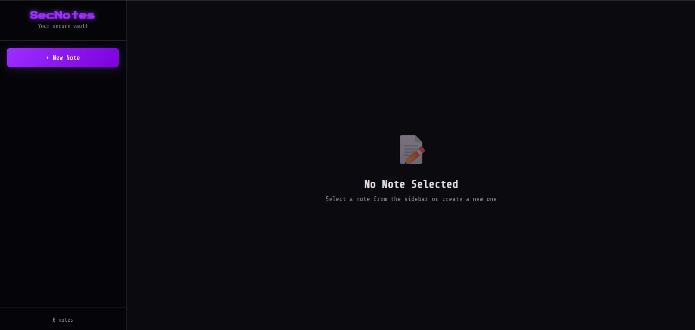

# Secure Notes

---

## Category: Web | Difficulty: Easy | Approach: White-box

---

### PART I: Vulnerability

NoSQL Injection in the `/update` endpoint, combined with a known Mongoose Prototype Pollution vulnerability (CVE-2023-3696), allows an unauthenticated attacker to forge the value `req.connection.remoteAddress` reads, bypassing the localhost-only access control on `/flag` and disclosing the flag.

---

### PART II: Application Mapping

- The landing page displays only the `New Note` feature.
    
    
    
- Creating a new note requires two inputs.
    
    
    
- The note appears in the left panel after creation. Clicking it allows me to view and modify its content, then either save the changes or delete the note.
    
    
    
- Here is the entire map:
    
    
    

---

### PART III: Source Code Reviewing

#### III.1: Flag Location

- File: `src/app.js`:
    
    ```jsx
    app.get('/flag', (req, res) => {
        const remoteAddress = req.connection.remoteAddress;
        if (remoteAddress === '127.0.0.1' || remoteAddress === '::1' || remoteAddress === '::ffff:127.0.0.1') {
            res.send(process.env.FLAG ?? 'HTB{f4k3_fl4g_f0r_t3st1ng}');
        } else {
            res.status(403).json({ Message: 'Access denied' });
        }
    });
    ```
    
    - The flag is exposed through a dedicated route, but access is restricted to localhost. 
    The application uses `req.connection.remoteAddress` to retrieve the client's IP address from the TCP connection, which I cannot directly control through an HTTP request.
    - The goal is therefore to find a way to manipulate `req.connection.remoteAddress` and make the application treat the request as originating from `127.0.0.1`.

#### III.2: Vulnerable Route

- File: `src/app.js`:
    
    ```jsx
    app.post('/update', async (req, res) => {
        try {
            const { noteId } = req.body;
            await Note.findByIdAndUpdate(noteId, req.body);
            let result = await Note.find({ _id: noteId });
            res.json(result);
        } catch (error) {
            console.error(error);
            res.status(500).json({ Message: "An error occurred" });
        }
    });
    ```
    
    - This route passes `req.body` directly to Mongoose's `findByIdAndUpdate()` without validation, allowing user-controlled data to reach the update operation.
    - Since MongoDB supports update operators (`$set` , `$rename`,…), an attacker can inject these operators to control how the update is performed, resulting in a NoSQL injection vulnerability.
- File: `src/package-lock.json`:
    
    ```json
    "node_modules/mongoose": {
          "version": "7.2.4",
    ```
    
    - The application uses Mongoose version 7.2.4, which is affected by CVE-2023-3696, as discussed below:
        - [[Reference 1](https://security.snyk.io/vuln/SNYK-JS-MONGOOSE-5777721)]
        - [[Reference 2](https://huntr.com/bounties/1eef5a72-f6ab-4f61-b31d-fc66f5b4b467)]

#### III.3: Research

- The `$rename` operator renames an existing field while preserving its value. It also accepts dot notation in the destination field path, allowing the field to be moved to a nested path.
- According to CVE-2023-3696, Mongoose's handling of certain update paths involving `__proto__` can lead to prototype pollution. By using `$rename` with a destination path containing `__proto__`, I can trigger this vulnerable behavior and influence the property used by `req.connection.remoteAddress`.
- But rather than attempting to overwrite `remoteAddress` directly, the attack targets `_peername.address`, the underlying property accessed by its getter.
- In Node.js, `req.connection` references a `net.Socket` instance. Its `remoteAddress` property is implemented as a getter on `Socket.prototype`, rather than a regular property stored directly on the socket instance. The inheritance chain is shown below:
    
    
    
- This is the source code of `remoteAddress` :
    
    ```jsx
    get remoteAddress() {
      if (this._peername) {
        return this._peername.address;
      }
      // If empty, call OS layer to check the IP.
    }
    ```
    
    - The getter retrieves the remote IP address from `this._peername.address`. If `_peername` is available, its `address` property is returned directly.
    - Since the getter is defined on `Socket.prototype`, property lookup finds it before reaching `Object.prototype`. Therefore, polluting `Object.prototype.remoteAddress` would not override the existing getter. Instead, the attack targets `_peername.address`, the value returned by the getter.

---

### PART IV: Exploitation

- Since `$rename` moves an existing field's value to the specified destination path, I first need to create a note containing the value I want to inject.
- First, I create a note with its `title` set to `127.0.0.1`.
    
    
    
- I then trigger the prototype pollution. From this point onward, the affected connections are treated as originating from localhost.
    
    
    
- Finally, I access the `/flag` endpoint to retrieve the flag.
    
    
    

---

### PART V: Impact

The application does not require authentication, allowing any remote attacker to access `/update` and perform the attack without privileged access. The vulnerability allows an unauthenticated attacker to bypass the localhost-only access control on `/flag` and disclose the flag. The root cause is not limited to the `/flag` route: the endpoint accepts attacker-controlled MongoDB update operators without validation, while the affected Mongoose version is vulnerable to prototype pollution.

---

### PART VI: Root Cause & Remediation

#### Root Cause:

- **NoSQL Injection**: `/update` passes `req.body` directly to `Note.findByIdAndUpdate()` without validation or a field allow-list, allowing client-supplied MongoDB update operators (`$rename`, `$set`, etc.) to reach the update operation.
- Known vulnerable dependency (CVE-2023-3696): The application uses Mongoose 7.2.4, an affected version in which handling update paths involving `__proto__` can lead to prototype pollution.
- **Access control trusts a value reachable through the pollution**: `/flag` authorizes based on `req.connection.remoteAddress`, which resolves through `this._peername.address` — a plain object property with no protection against being inherited from a polluted `Object.prototype`. The access control was never designed to account for the possibility that this property could be attacker-influenced.

#### Remediation:

- Never pass raw `req.body` directly into a MongoDB update operation. Explicitly allow-list the fields the endpoint is permitted to update (e.g., `content`), and reject unexpected keys or paths involving `__proto__`, `constructor`, or `prototype`.
- Upgrade Mongoose to a version containing the fix for CVE-2023-3696, and keep dependencies updated according to a regular patching schedule.
- Do not use a spoofable, pollutable property (`req.connection.remoteAddress`) as the sole access control for a sensitive endpoint. Enforce localhost-only access at the network/infrastructure layer (e.g. binding `/flag` to a separate internal-only listener, or a reverse proxy rule), independent of any value derived from user-influenced application state.
