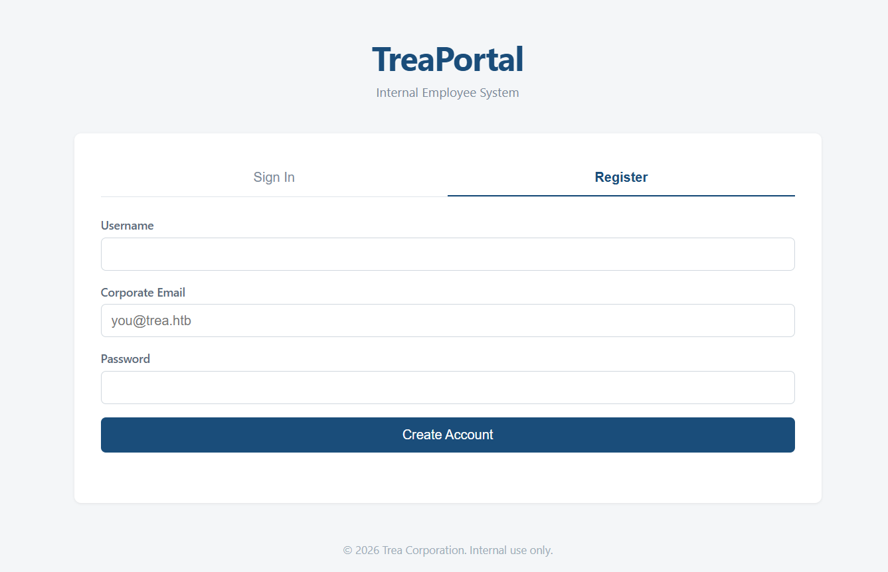

# TreaPortal

---

## Category: Web | Difficulty: Easy | Approach: White-box

---

### PART I: Vulnerability

XPath Injection (CWE-643) in `/api/user` allows an authenticated employee to bypass the endpoint's ownership check and input blacklist by supplying a repeated `username` parameter. The resulting array bypasses both checks and is coerced into an XPath expression, enabling unauthorized access to the administrator's record and flag.

---

### PART II: Application Mapping

- The landing page provides two options: `Sign In` and `Register`.
    
    
    
- The `Corporate Email` field has a placeholder that reveals the internal domain, allowing me to register an account and log in.
- After logging in, I can view my profile and its associated personal data. Below it, there is a feature for looking up other users' information, but access is restricted to my own profile during the migration.
    
    
    
- Searching for any other username returns an “Access denied” response.
    
    
    
- The `Dashboard` is static and unrelated to the attack path, so I will skip it. And the `Logout` is…to log out.
- Here’s the entire application map:
    
    
    

---

### PART III: Source Code Analysis & Exploitation

#### III.1: Flag Location

- File: `src/db/init.ts`:
    
    ```tsx
    const FILE = path.join(__dirname, "users.xml");
    
    async function readFlag(): Promise<string> {
        ...
    }
    
    async function createDatabase(): Promise<void> {
        const hashedPassword: string = await bcrypt.hash(randomUUID(), 13);
        const flag = await readFlag();
    
        const xml = `<?xml version="1.0" encoding="UTF-8"?>
        <users>
            <user>
                <id>1</id>
                <username>admin</username>
                <email>admin@trea.htb</email>
                <password>${hashedPassword}</password>
                <salary>15000</salary>
                <role>administrator</role>
                <flag>${flag}</flag>
            </user>
        </users>
        `
    
        await fs.writeFile(FILE, xml, 'utf-8')
    }
    export async function initialize(): Promise<void> {
    		...
    		catch {
            await createDatabase()
        }
    }
    ```
    
    - This file creates an administrator record containing the flag during the initial database setup.
- File: `src/services/userServices.ts`:
    
    ```tsx
    export async function createUser(username: string, email: string, password: string) {
    		...
        idEl.textContent = id.toString();
        usernameEl.textContent = username;
        emailEl.textContent = email;
        passwordEl.textContent = hashed_password;
        salaryEl.textContent = (1000).toString();
        roleEl.textContent = "employee";
        flagEl.textContent = "";
    		...
    }
    ```
    
    - Registration adds a new `<user>` node with the employee role and an empty flag field. This establishes the main objective: retrieving the administrator's record.

#### III.2: Input Mapping

- Since the `Search` feature is the only input point, tracing the input from source to sink is the most effective approach.
- Searching for an employee sends the following request, which returns TOO MUCH data that the UI never renders.
    
    
    
- In case the username is not mine, the application returns “Access denied”.
    
    
    
- I first traced the `username` input across the source code and mapped its path, as shown below. Reading the source code will be easier when having a map.
    
    
    

#### III.3: Breaking the Defenses

- File: `src/routes/user.ts`:
    
    ```tsx
    export async function user(fastify: FastifyInstance) {
    
        fastify.get('/', { preHandler: [fastify.authenticate] }, async (req, res) => {
    
            const { username } = req.query as any
            const tokenPayload = req.user as IJwtPayload
    
            // Temporarily restricted during migration.
            // TODO: reimplement with request schema validation
            if (typeof username === 'string' && username !== tokenPayload.username) {
                return res.status(403).send({ err: 'Access denied' })
            }
    
            const user = await getUserByUsername(username)
    
            if (!user) {
                return res.status(404).send({ err: 'User not found' })
            }
    
            return {
                username: user.username,
                email: user.email,
                salary: user.salary,
                role: user.role,
                flag: user.flag
            }
        })
    }
    ```
    
    - This route returns a JSON object containing the searched user's profile fields, including the flag.
    - Unlike the `/api/auth` routes, this route does not validate its query parameters against a schema. As a result, `username` can retain the type produced by the query parser instead of being validated as a string.
    - Fastify's default query-string parser (`fast-querystring`) converts repeated query parameters into an array. For example, `?username=a&username=b` becomes `{ username: ['a', 'b'] }`.
    - Because the access check only runs when username is a string (`if (typeof username === 'string' && ...)` ), sending a non-string `username` (an array) skips the check entirely and falls through to `getUserByUsername()`.
        
        
        
- File: `src/services/userServices.ts` :
    
    ```tsx
    function looksLikeXPathInjection(input: string): boolean {
        const blacklist = ["'", ';', 'or', 'and', ')', "(", "/" , "doc"] ;
        return blacklist.some(pattern => input.includes(pattern));
    }
    
    export async function getUserByUsername(username: any): Promise<IUser | null> {
        if (looksLikeXPathInjection(username)) throw new Error('bad')
        const doc = await getDoc()
        const node = xpath.select1(`//user[username='${username}']`, doc as any)
        return nodeToUser(node)
    }
    ```
    
    - `getUserByUsername()` performs another check on `username`  using `looksLikeXPathInjection()` before interpolating it directly into the XPath query.
    - The problem is that `looksLikeXPathInjection()` uses `.includes()`. When the input is a string, `includes()` checks whether a substring is present. When the input is an array, it checks whether an element exactly matches the specified value.
    - This means that an array-valued `username` can bypass the check as long as none of its elements exactly matches a blacklisted value, ultimately allowing XPath injection.
    - Failed attempt:
        
        
        
    - Successful attempt:
        
        
        
    - When an array is interpolated into a template literal (``...${username}...``), JavaScript implicitly converts it to a string by calling its `toString()` method. For an array, `Array.prototype.toString()` produces the same result as `Array.prototype.join(',')`. Therefore, `['a', 'b']` becomes `"a,b"`.
    
    #### III.4: Finishing Move
    
    - The final payload is constructed as follows:
        
        
        
    - Since the first node contains administrator’s record, the query returns the admin record and exposes the flag.
        
        
        

---

#### PART IV: Impact

- Self-registration has a low barrier to entry because the internal domain is exposed in the registration form's placeholder. As a result, an external attacker can register an employee account and exploit the endpoint with little effort. Once exploited, the endpoint can disclose the administrator's record, including sensitive fields such as salary and flag. If the XPath expression can be crafted to target other users, the same vulnerability may expose their records as well.
- **Severity: High.**
    - The vulnerability has a low barrier to entry and can expose sensitive information from the administrator's record. If a crafted XPath predicate can target arbitrary users, the impact may extend to other user records.

---

#### PART V: Root Cause & Remediation

- **Root Cause:**
    - **XPath Injection (CWE-643):** `getUserByUsername()` constructs the XPath query through raw string interpolation (`//user[username='${username}']`) instead of safely binding or escaping the input. As a result, attacker-controlled input can be interpreted as XPath syntax rather than data.
    - **Type safety bypassed at the entry point:** The `req.query as any` assertion bypasses TypeScript's static type checking. It does not validate or convert the runtime value, allowing an array to reach a function that is declared to accept a string and eventually flow into the XPath query.
    - **Both defenses assume that `username` is a string:** The ownership check (`typeof username === 'string'`) skips validation for arrays, while the blacklist uses array `includes()` semantics, which check for exact element matches rather than substring matches. As a result, repeated query parameters can produce an array that bypasses both checks.
    - **Excessive data exposure:** The endpoint returns sensitive fields such as `salary` and `flag` regardless of whether the frontend needs them. Once an attacker can retrieve a user's record, these fields are exposed in the response without requiring an additional request.
- **Remediation:**
    - **Validate query parameters:** Define a Fastify JSON Schema for `querystring` that requires `username` to be a single string and rejects array values. This closes the array-based bypass at the entry point instead of relying solely on type checks within individual functions.
    - **Prevent XPath injection:** Avoid interpolating user input directly into the XPath expression. Use a parameterized query mechanism if the library supports one; otherwise, apply context-appropriate XPath escaping or use a safe query-building approach that separates the expression from the input data.
    - **Preserve type safety:** Avoid using `as any` on request input. Use schema validation to validate the runtime value and provide appropriate TypeScript types, rather than bypassing the type system with a cast.
    - **Minimize response data:** Return only the fields required by the UI (`username`, `email`, `role`). Sensitive fields such as `salary` and `flag` should not be included in a general-purpose user lookup response unless explicitly required and authorized.
